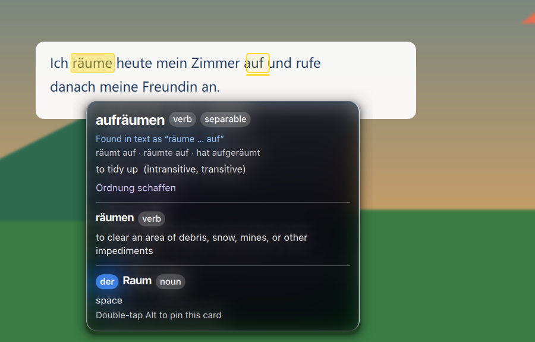
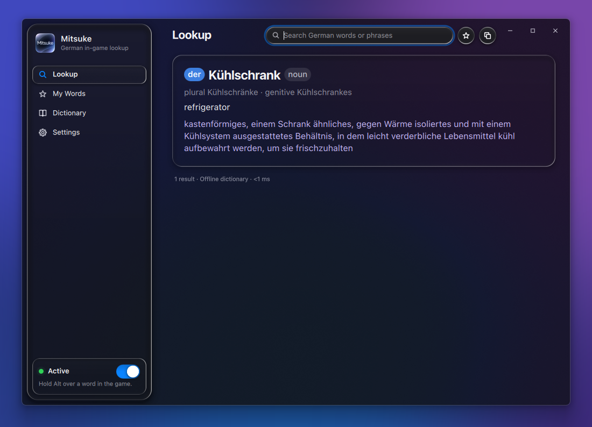
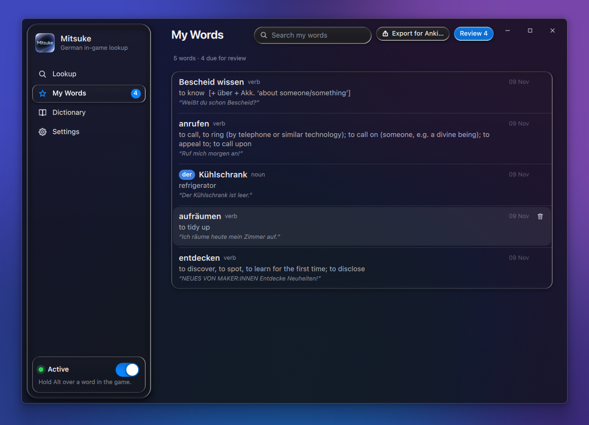
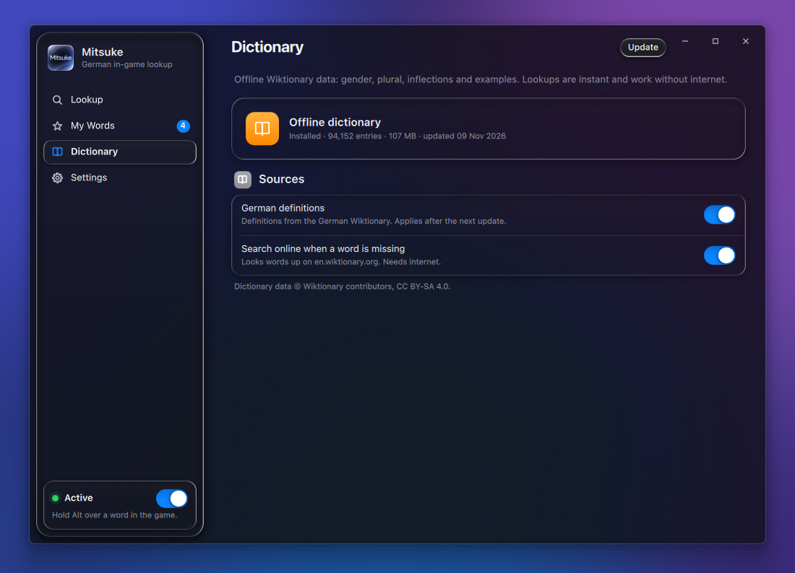
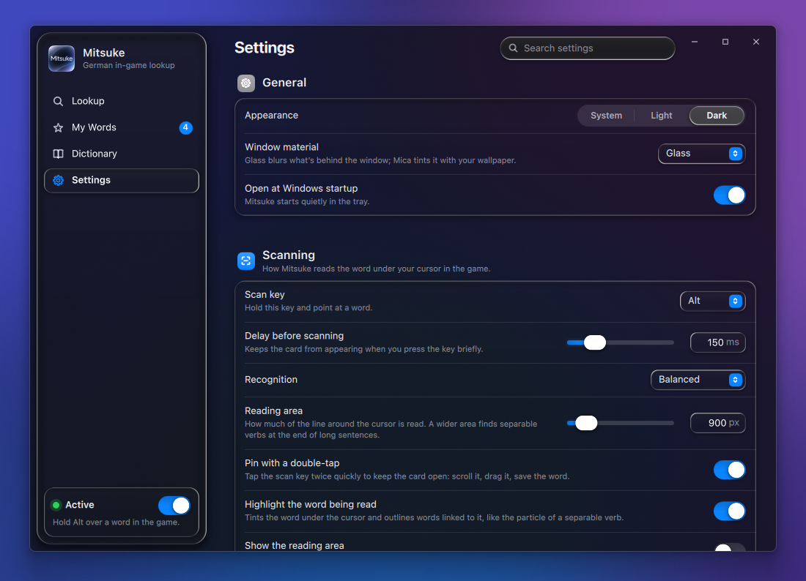
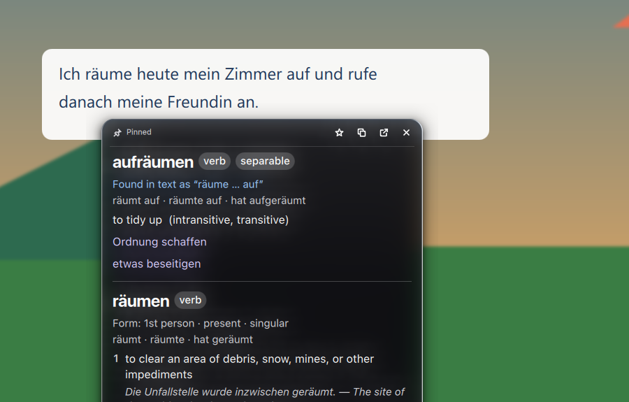
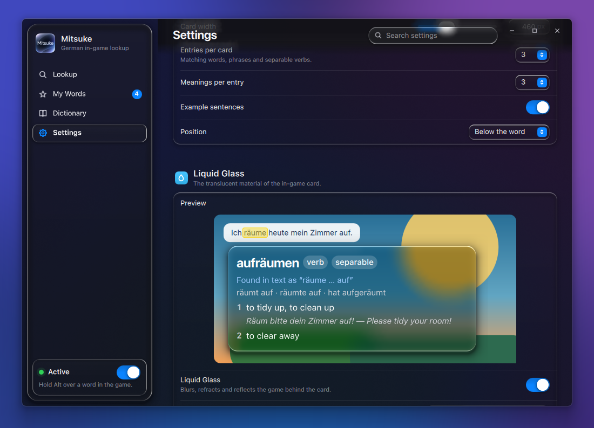
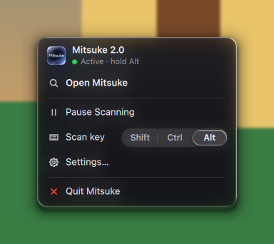

# Mitsuke

A German dictionary that works on top of games and any other Windows app. Hold a key, point at a German word on
screen, and a card appears next to it with the article (der / die / das), word forms, English translations,
German definitions and examples — without leaving the game.



## Features

- **Reads any text on screen** with Windows' built-in text recognition (OCR) — game dialogue, menus, videos,
  anything that isn't selectable text.
- **Understands real sentences**: phrases (*auf jeden Fall*), separable verbs split across a sentence
  (*räume … auf* → **aufräumen**), verbs with prepositions, compound words, inflected forms and words broken
  across lines.
- **Highlights what it read**: the word under the cursor and the words linked to it, such as the particle of a
  separable verb.
- **Offline dictionary** built from English and German Wiktionary (about 200 000 entries, 1.2 million word forms), with
  online lookup as a fallback. Compounds that aren't in it (*Abschlussball*, *Live-Modus*) are explained from their
  parts, with gender and plural taken from the last part.
- **Pin a card** with a double-tap of the key to scroll it, move it and save the word.
- **My Words**: saved words with the sentence they came from, spaced-repetition review and Anki export.
- **Modern translucent interface** rendered on the GPU, dark and light appearance, and accessibility options
  (reduce transparency, increase contrast, reduce motion).
- **Updates** from GitHub Releases, verified with SHA-256.

## Screenshots

| | |
|---|---|
|  |  |
| **Lookup** — search any word or phrase | **My Words** — saved words and review |
|  |  |
| **Dictionary** — offline data and sources | **Settings** — scanning, card and appearance |
|  |  |
| **Pinned card** — stays open, scrolls, saves | **Card preview** — updates live with the settings |

<p align="center"><br><b>Tray menu</b></p>

## Getting started

1. Download the latest `Mitsuke-*-win64.zip` from [Releases](../../releases), unzip it anywhere and run
   `Mitsuke.exe`. It lives in the tray.
2. On first start Mitsuke offers to install Windows' German text recognition (a few MB) and to download the
   offline dictionary (about 55 MB; it's rebuilt from Wiktionary every month).
3. In the game, use **borderless windowed** mode, hold **Shift** (or Ctrl / Alt — see Settings) and point at a
   word.

Requires Windows 10 or 11 (64-bit).

## Building from source

- Python 3.10–3.14 (64-bit).
- `run_dev.bat` installs the requirements and starts the app.
- `build_exe.bat` builds `dist\Mitsuke\Mitsuke.exe` (keep the whole folder together).
- The UI is Qt Quick (PySide6). The glass shader in `gui/qml/Mitsuke/shaders` is precompiled; after editing
  `glass.frag`, rebuild it with `pyside6-qsb` (from PySide6-Addons):

  ```
  pyside6-qsb --glsl "150,300es" --hlsl 50 --msl 12 -o glass.frag.qsb glass.frag
  ```

- Pushing a tag such as `v2.1` builds the app on GitHub Actions and publishes a release.
- The `dictionary` workflow rebuilds the offline dictionary from Wiktionary (monthly, or on demand) and publishes
  it as the `dictionary` pre-release that the app downloads.

| Path | Contents |
|---|---|
| `main.py` | app core: key → OCR → lookup → card |
| `ocrword.py` | screen capture, Windows OCR, context around the cursor |
| `dictcore.py`, `engine.py`, `build_dict.py`, `online.py` | dictionary: parsing, phrases, building the database from Wiktionary |
| `render.py` | word card model shared by the window and the overlays |
| `words.py` | My Words and spaced repetition |
| `gui/` | interface: Python ↔ QML bridge, overlays, Windows materials, QML components and shader |
| `tests/` | unit tests and an OCR accuracy bench on synthetic game frames |

## Data and privacy

Settings, the dictionary, saved words and the log stay on your computer in `%APPDATA%\Mitsuke`. Screen captures
are processed locally and never saved or sent anywhere; the only network requests are online word lookups
(en.wiktionary.org, when a word isn't in the offline dictionary), dictionary downloads and update checks.

Dictionary data © Wiktionary contributors, licensed under CC BY-SA 4.0, via [kaikki.org](https://kaikki.org).
